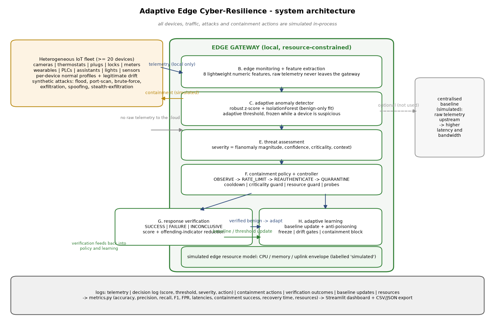
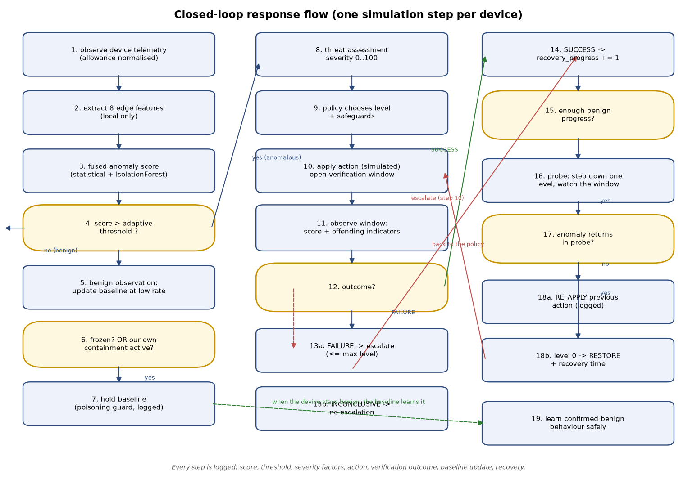

# Adaptive Edge Cyber-Resilience for Resource-Constrained IoT Networks

**Research title.** *Design and Development of an Adaptive Edge Cyber-Resilience Mechanism for
Real-Time Detection and Autonomous Containment of Unknown Attacks in Resource-Constrained IoT
Networks.*

**What this is.** A complete, runnable, fully local **simulation** of an edge gateway that

1. monitors a heterogeneous fleet of simulated IoT devices,
2. learns what normal behaviour looks like per device (benign data only),
3. scores every observation with a lightweight fused anomaly detector,
4. decides whether a deviation is suspicious while protecting the learned baseline from poisoning,
5. estimates severity from anomaly magnitude, detector confidence, device criticality and network context,
6. chooses a resource-aware containment action (observe → rate-limit → re-authenticate → quarantine),
7. verifies whether the action actually reduced the offending behaviour, escalates if not, and
8. recovers (probing one level at a time) and safely re-learns behaviour that is confirmed benign.

**What this is not.** It is *not* production software, and the results it produces are **not** evidence
of real-world security effectiveness. Every "device", attack, and containment action is a synthetic
object inside the Python process. The code never scans a network, never contacts a real device,
never changes a firewall rule, and never performs a real attack. It needs no cloud account, no paid
API, no GPU and no internet access at runtime.

---

## 1. Project structure

```
adaptive_iot_resilience/
  app.py                     Streamlit dashboard (10 sections, see §7)
  config.py                  Every tunable parameter: fleet, attacks, thresholds, weights, resources
  conftest.py                pytest fixtures (shared simulation world)
  requirements.txt           Runtime dependencies (no cloud/GPU/paid services)
  README.md                  This document: architecture, algorithm, methodology, results, limitations
  src/
    traffic_simulator.py     A. device fleet + normal telemetry + legitimate shifts + synthetic attacks
    feature_extractor.py     B. edge feature extraction (8 features) + simulated edge resource model
    anomaly_detector.py      C. statistical + IsolationForest fused detector, static/adaptive threshold,
                                per-device thresholds, suspicion freeze
    threat_assessment.py     E. severity = f(magnitude, confidence, criticality, network context)
    containment.py           F. containment policy + closed-loop controller (guards, cooldowns, probes)
    response_verifier.py     G. post-action effectiveness verification (SUCCESS/FAILURE/INCONCLUSIVE)
    adaptive_learning.py     H. baseline adaptation + anti-poisoning safeguards + audit log
    metrics.py               5. all evaluation metrics, computed from the logs (zero-denominator safe)
    experiment_runner.py     4/10. runs S1/S2/S3 on identical traffic, saves CSVs + JSON + figures
    figures.py               9. evaluation charts, architecture diagram and closed-loop flowchart
  tests/
    test_simulator.py        normal traffic generation, fleet, attack scheduling, reproducibility
    test_detector.py         detection of injected scenarios, held-out patterns, threshold/freeze logic
    test_containment.py      severity bands, safeguards, cooldowns, escalation, probes, recovery
    test_learning.py         drift gates, poisoning safeguards, bounded updates, drift learning
    test_metrics.py          exact metric values, zero denominators, latency and containment accounting
    test_reproducibility.py  same seed → identical telemetry, decisions and metrics
  data/                      (free space for exported datasets)
  results/<scenario>/        CSV logs, metrics tables, experiment_summary.json
  figures/                   generated PNG figures
```

---

## 2. Installation (Windows 11 / VS Code / PowerShell)

```powershell
# 1. create and activate a virtual environment
cd adaptive_iot_resilience
python -m venv .venv
.\.venv\Scripts\Activate.ps1
#   (if activation is blocked:  Set-ExecutionPolicy -Scope Process -ExecutionPolicy Bypass)

# 2. install dependencies
python -m pip install --upgrade pip
python -m pip install -r requirements.txt
```

The pinned range is deliberately light: `numpy`, `pandas`, `scikit-learn`, `matplotlib`,
`streamlit`, `pytest`. Python 3.11 or 3.12 (the reference environment is Windows 11 with
Python 3.12.2).

### 3. Run the unit tests

```powershell
python -m pytest tests -q
```

### 4. Generate the experimental results

```powershell
# full suite: main scenario, low-resource edge scenario, and a second seed
python -m src.experiment_runner

# faster smoke run (200 steps instead of 360)
python -m src.experiment_runner --quick
```

This writes `results/<scenario>/*.csv`, `results/<scenario>/experiment_summary.json` and the figures
in `figures/`.

### 5. Launch the dashboard

```powershell
python -m streamlit run app.py
```

The dashboard opens at <http://localhost:8501>. If `results/` is empty it offers a button that runs a
quick experiment first.

### 6. Export figures and results

* CSV logs and the JSON summary are written automatically by step 4 to `results/`.
* Figures are written to `figures/` by step 4; add `--no-figures` to skip them.
* The dashboard also offers per-table CSV download buttons and a JSON summary download.

---

## 3. System architecture



Text version of the same architecture:

```
┌──────────────────────────────────────────────────────────────────────────────┐
│ Simulated IoT fleet (>= 20 heterogeneous devices, per-device normal profiles)│
│ cameras · thermostats · plugs · door locks · meters · wearables · PLCs ·      │
│ assistants · lights · irrigation  +  legitimate behaviour shifts             │
└───────────────────────────────┬──────────────────────────────────────────────┘
                                │ telemetry (stays local: nothing is sent upstream)
                                ▼
┌──────────────────────────────────────────────────────────────────────────────┐
│ EDGE GATEWAY (simulated resource envelope: CPU, memory, uplink, latency)     │
│                                                                              │
│  B. feature extraction (8 numeric features, labels never included)           │
│            │                                                                 │
│  C. adaptive anomaly detector  ── benign-only calibration ──┐                │
│            │  fused score + per-device adaptive threshold   │                │
│            │  suspicion freeze (no learning while flagged)  │                │
│            ▼                                                │                │
│  E. threat assessment: severity 0..100 (magnitude,          │                │
│     confidence, criticality, network context)               │                │
│            │                                                │                │
│            ▼                                                │                │
│  F. containment policy + controller  (OBSERVE → RATE_LIMIT → │               │
│     REAUTHENTICATE → QUARANTINE; cooldown, criticality,      │               │
│     resource and graduation guards, probes)                  │               │
│            │                                                 │               │
│            ▼                                                 │               │
│  G. response verifier (score + offending-indicator reduction)│               │
│            │                                                 │               │
│            └────────────────────────────────────────────► H. adaptive learning│
│                          verified benign only ────────────────┘ (baseline     │
│                                                                update with    │
│                                                                anti-poisoning)│
└──────────────────────────────────────────────────────────────────────────────┘
                                │
                                ▼
   logs (decisions, actions, verifications, baseline updates, resources)
                                │
                                ▼
   metrics.py  →  dashboard (Streamlit)  +  CSV/JSON exports  +  figures
```

A **centralised (cloud) baseline** is *estimated for comparison only*: the resource model computes
what shipping one raw telemetry record per device per step would cost in simulated uplink bandwidth
and latency, versus the small alert summary an edge-resident detector sends. No network traffic is
generated.

---

## 4. Algorithm and pseudocode

### 4.1 Feature extraction (8 lightweight features)

| # | Feature | Definition |
|---|---------|------------|
| 1 | `pkt_rate_ratio` | packet rate ÷ learned normal packet rate (1.0 = normal) |
| 2 | `bytes_rate_ratio` | bytes/s ÷ learned normal bytes/s |
| 3 | `failed_auth_rate` | failed authentication attempts in this step (absolute count) |
| 4 | `conn_count_z` | (connections − normal) ÷ robust scale |
| 5 | `dest_diversity_z` | (distinct destinations − normal) ÷ robust scale |
| 6 | `cpu_delta` | (device CPU% − normal) ÷ 100 |
| 7 | `mem_delta` | (device memory% − normal) ÷ 100 |
| 8 | `protocol_shift` | 0 = usual protocol, 1 = unusual but permitted, 2 = never seen |

Device criticality, attack type and labels are **not** features.

### 4.2 Detection

```
CALIBRATE(all benign observations of the calibration window [0, T_cal)):
    for each device d:
        median_d, mad_d  <- per-feature robust location/scale
        if_score_d       <- IsolationForest(n_estimators, max_samples, benign data only)
        threshold_d      <- quantile(benign fused scores of d, 0.995) * 1.05
                            clipped to [threshold_min, threshold_max]
    seed each device's benign score window with its calibration scores

SCORE(step, device d, observation x):
    contrib_f        <- |x_f - median_{d,f}| / scale_{d,f}  squashed by z/(z+4)
    stat_score       <- 0.5 * max(contrib) + 0.5 * mean(contrib)
    if_score         <- squash((median_d(decision) - decision(x)) / (1.4826*MAD_d))
    score            <- (0.6*stat_score + 0.4*if_score) / (0.6 + 0.4)
    is_anomalous     <- score > threshold_d
    if is_anomalous and device not frozen:  freeze device
    if adaptive and not frozen and not anomalous:
        append score to the device's benign window
        threshold_d <- (1-0.002)*threshold_d + 0.002*quantile(window, 0.99)   # EWMA
    if frozen and score <= threshold_d for unfreeze_patience steps: release freeze
    return score, threshold_d, is_anomalous, per-feature contributions
```

The detector only ever sees features. Labels exist in the logs for evaluation.

### 4.3 Severity

```
severity = 100 * (0.35*magnitude + 0.25*confidence + 0.20*criticality + 0.20*context)
             / (0.35 + 0.25 + 0.20 + 0.20)

magnitude  = clamp((score - threshold) / (threshold*(saturation-1)), 0, 1)   # threshold-relative
confidence = 0.5*(1 - |stat_score - if_score|) + 0.5*magnitude                # scorer agreement
criticality= {low .25, medium .5, high .75, critical 1.0}                    # asset importance
context    = 0.6*(fraction of fleet currently anomalous) + 0.4*(device share of fleet bytes/s)
```

All weights, the saturation factor and the criticality map are configurable in `config.SeverityConfig`.

### 4.4 Containment policy

```
DECIDE(severity, state, cpu_free):
    level    <- 0 if severity <= 25; 1 if <= 50; 2 if <= 75; else 3
    if level == 3 and criticality == critical and severity < 85:  level <- 2   # critical-asset guard
    if level == 3 and no lighter action tried yet:                level <- 2   # graduated response
    if cpu_free < min_required:                                   level <- 0   # resource guard
    while action_cost[level] > cpu_free:                          level -= 1   # resource downgrade
    return level

CONTROL(step, device, score, severity, indicators, telemetry_available, cpu_free):
    (1) if a verification window is open: feed it score + offending indicators
        if it closed as FAILURE (and escalations < max): escalate one level
    (2) if the device is anomalous:
            desired <- DECIDE(severity, state, cpu_free)
            if desired <= current level:
                 if current level == 0: log OBSERVE
                 elif anomaly_streak >= sustained_anomaly_steps: escalate one level
            elif inside cooldown and severity jump < escalation_severity_jump: log HOLD
            else: escalate / apply, open a verification window, start the cooldown
            if probing: revert the probe (RE_APPLY the previous action)
    (3) else (benign, or fully isolated with no telemetry):
            advance recovery progress when the current action was verified effective
            when recovery_steps reached:
                 level > 1 -> step down one level as a probe (revert if the anomaly returns)
                 level == 1 -> RESTORE, log the recovery time
```

Action effects (simulated): OBSERVE 100% allowance, RATE_LIMIT 35%, REAUTHENTICATE 10%,
QUARANTINE 0% (and no telemetry at all). Detection works on *allowance-normalised* telemetry, so
the gateway's own throttling cannot create or hide an anomaly; the verifier deliberately looks at the
raw post-action traffic, because that is what an action is supposed to change.

### 4.5 Verification and recovery

```
on action A at step t:
    record score_before and the raw values of the (up to 3) features that triggered the alarm
    open a window of observation_window (4) steps
in the window: collect scores and the same indicators
close the window:
    if fewer than observation_window steps observed:      INCONCLUSIVE
    elif score_after <= 0.20:                             SUCCESS  (back to the normal band)
    elif mean indicator reduction >= 0.35:                SUCCESS  (offending behaviour reduced)
    elif score reduction >= 0.35:                         SUCCESS
    else:                                                 FAILURE  (no measurable effect)
```

`INCONCLUSIVE` is reported, never silently counted as a success or a failure.

### 4.6 Closed-loop learning with anti-poisoning safeguards

```
STEP(step, device, observation, score, threshold, is_anomalous, features, allowance):
    if allowance < 0.25:                       log blocked_containment     # our own throttle distorts data
    elif is_anomalous:
        if DRIFT_GATES(features) for drift_patience consecutive steps:
            release the freeze for the *volume* features only, learn at 0.10
            (log drift_release with the exact gate values)
        else:
            freeze the device baseline, log blocked_anomalous with the gate values
    elif frozen:                               log blocked_frozen, count benign streak
    elif score >= 0.6*threshold:               learn slowly (0.04)             # possible benign drift
    else:                                      learn normally (0.05)           # clean benign

DRIFT_GATES(features):        # all must hold
    0.25 <= pkt_rate_ratio <= 2.2 and 0.25 <= bytes_rate_ratio <= 2.2
    failed_auth_rate <= 0
    protocol_shift == 0
    |conn_count_z| <= 3 and |dest_diversity_z| <= 3
    |cpu_delta| <= 0.15 and |mem_delta| <= 0.15
```

Every update *and every refusal* is logged with step, device, mode, learning rate, score, threshold
and (for releases and refusals) the gate values, so the guard's behaviour is auditable.

---

## 5. Closed-loop flowchart



```
observe telemetry → extract features → fused score
        │
        ├── score <= threshold ──► benign: learn at a low rate, unless the baseline is frozen or
        │                          our own containment distorted the telemetry (log the refusal)
        │
        └── score >  threshold ──► severity assessment
                                     │
                                     ▼
                              policy + safeguards (criticality, resource, graduated response, cooldown)
                                     │
                                     ▼
                              apply action (simulated) + open a verification window
                                     │
                                     ▼
                              observe the window: score and offending indicators
                                     │
             ┌───────────────────────┼────────────────────────┐
             ▼                       ▼                        ▼
          FAILURE                INCONCLUSIVE              SUCCESS
     escalate (<= max level)   no escalation, keep        recovery progress += 1
             │                 monitoring                        │
             └──────────────► back to the policy                 ▼
                                                   enough progress → probe one level down
                                                                │
                                            anomaly returns? ── yes ─► RE_APPLY previous action
                                                                │
                                                                no
                                                                ▼
                                                     level 0 → RESTORE (log recovery time)
                                                                │
                                                                ▼
                                                    learn the confirmed-benign behaviour
```

---

## 6. Datasets and synthetic-data limitations

There is **no public dataset** in this project: the fleet, the traffic and the attacks are generated
by `src/traffic_simulator.py` from a fixed seed. That choice buys reproducibility and lets the
experiment control exactly which patterns are "unknown", at the cost of realism.

* **Normal behaviour** is a per-device profile (base packet rate, bytes/s, connections, destination
  diversity, CPU, memory, protocol) modulated by a 144-step daily cycle, 7–9% multiplicative noise,
  and a 0.4%-per-step benign burst that makes the false-positive measurement honest.
* **Legitimate behaviour shifts** occur at 55% and 78% of the run for a quarter of the *non-attacked*
  devices: their volume changes by ~35% in a stable direction. A static threshold should keep
  flagging them; an adaptive system should absorb them.
* **Attacks** are parameter combinations applied on top of the device profile: `flood`, `port_scan`,
  `brute_force`, `exfiltration` (development patterns) and `spoofing`, `stealth_exfiltration`
  (**held-out**, never used while calibrating or tuning anything). Attack durations are 8–30 steps and
  start after the calibration window.
* **Held-out ≠ zero-day.** The held-out patterns are still authored by the same person who wrote the
  detector, and they are only a *proxy* for an attack family that no real deployment has seen. Recall
  on them is reported separately (see §8) and must not be presented as proof of zero-day detection.
* **No real traffic distribution is claimed.** Real IoT fleets have burstier, correlated and
  protocol-specific behaviour than this generator produces.
* **Containment effects are modelled, not measured.** Reducing the allowance scales the volume
  features and dampens the attack-driven part of CPU/memory load. Real rate limiting has queues,
  retries and feedback effects that are not modelled.

---

## 7. Experimental methodology

Three systems run over **identical** traffic (same seed, fleet, attack schedule, benign shifts):

| ID | System | Threshold | Baseline | Containment |
|----|--------|-----------|----------|-------------|
| S1 | Static threshold | calibrated once on benign data, then frozen | frozen (never updated) | none |
| S2 | Adaptive detection | adaptive, per device, EWMA of the benign 0.99 quantile | adaptive with anti-poisoning guards | none (detection only) |
| S3 | **Proposed closed loop** | same as S2 | same as S2 | full policy + verification + recovery |

Fairness rules enforced by the runner:

* identical telemetry and attack schedule for all systems (same seed);
* calibration happens on the benign window only, for every system;
* the detector never receives labels, attack type or criticality; labels appear only in `metrics.py`;
* network context is taken from the previous step's fleet state, so no step uses future information;
* containment effects are applied to the observed stream for all systems identically (S1/S2 have no
  actions, so nothing is suppressed);
* scenarios: the **main** run; **low_resource** (CPU capacity 0.36, memory 128 MB, uplink 512 kbps,
  higher latency: only the cheapest response stays affordable, so every stronger action is
downgraded to RATE_LIMIT); **starved_edge** (CPU capacity 0.30: the gateway cannot afford to act at
all and can only OBSERVE - an honest failure mode); and a **second seed** run (`seed 2027`).
  All scenarios share the fleet and the attack schedule of the main run, so differences isolate the
effect being studied.

---

## 8. Results

All numbers below were produced by `python -m src.experiment_runner` on the reference machine; the
raw logs, the JSON summary and the figures are in `results/` and `figures/`. See
`results/<scenario>/comparison_table.csv` for the machine-readable version.

### Main scenario — seed `20261013`, 24 devices, 360 steps (120 benign calibration steps), 11 injected
attacks (7 development + 4 held-out patterns)

| metric | S1 static | S2 adaptive (no containment) | S3 proposed closed loop |
|--------|-----------|------------------------------|--------------------------|
| accuracy | 0.9670 | 0.9906 | 0.9905 |
| precision | 0.4958 | 0.7830 | 0.7182 |
| recall | 0.9519 | 0.9840 | 0.9774 |
| F1 | 0.6520 | 0.8720 | 0.8280 |
| false-positive rate (all benign steps) | 0.0325 | 0.0092 | 0.0092 |
| FPR, stable benign devices | 0.0063 | 0.0059 | 0.0059 |
| FPR, **legitimately drifted** devices | 0.3066 | 0.0432 | **0.0432** |
| recall, development patterns | 0.9300 | 0.9900 | 0.9886 |
| recall, **held-out (unseen) patterns** | 0.9770 | 0.9770 | 0.9556 |
| missed attacks (episodes) | 0 / 11 | 0 / 11 | 0 / 11 |
| detection latency (steps, mean) | 0.09 | 0.00 | 0.00 |
| response latency (steps, mean) | n/a | n/a | 0.00 |
| containment actions | 0 | 0 | 61 |
| containment success rate (S/F/I) | n/a | n/a | **0.816** (31/7/5) |
| recoveries / mean recovery time | 0 | 0 | 22 / 23.9 steps |
| quarantine actions | 0 | 0 | 10 |
| **unnecessary quarantines** (benign ground truth) | 0 | 0 | **0** |
| device-steps not scored (fully isolated) | 0 | 0 | 79 (1.4%) |
| drift adaptation time (steps, median) | 2 | 7 | 7 |
| simulated CPU utilisation (mean) | 0.288 | 0.288 | 0.290 |
| simulated memory footprint (mean) | 76.8 MB | 76.8 MB | 76.8 MB |
| simulated uplink, centralised : edge | 50.4x | 50.4x | 43.8x |
| measured wall clock per step | 69 ms | 75 ms | 35 ms |
| measured peak Python allocation | 0.154 MB | 0.175 MB | 0.191 MB |

Readings of the main run:

* **Adaptivity, not containment, drives detection quality.** S2 and S3 cut the false-positive rate of the
  static threshold by ~3.5x and reduce the false-positive rate on legitimately drifted devices from
  **30.7% to 4.3%** — a device that changes its behaviour by 35% is learned instead of being flagged
  forever. Neither system was given labels.
* **The closed loop works and does not wreck detection.** S3 adds 61 containment actions, verifies
  81.6% of them as effective, restores 22 devices (mean 24 steps to full recovery) and performs
  **0 unnecessary quarantines** in this scenario. Its slightly lower recall (0.977 vs 0.984) comes from
  the 79 device-steps (1.4%) in which a quarantined device emits no telemetry at all: those steps are
  excluded from the point-wise metrics and counted separately instead of being scored as misses.
* **Held-out patterns are detected too** (95.6-97.7% recall here), but this is a proxy for unknown
  attacks, not evidence of zero-day generalisation (see §11).
* **Centralised processing costs ~40-50x more simulated uplink** than shipping only gateway summaries.
* `measured_*` figures are real host measurements, but they vary with machine load between runs
  (the same 24-device scenario measured between 35 and 146 ms per step across the runs recorded
  here), so they are reported as an order of magnitude rather than as a benchmark.

### Resource-constrained scenarios (same seed, fleet and attacks)

| scenario (simulated CPU capacity) | containment actions | quarantine | success rate | mean recovery | simulated CPU utilisation |
|------------------------------------|--------------------|------------|--------------|---------------|---------------------------|
| main (1.00) | 61 | 10 | 0.816 | 23.9 steps | 0.29 |
| low_resource (0.36) | 84 (all RATE_LIMIT) | 0 | 0.730 | 18.2 steps | 0.80 |
| starved_edge (0.30) | **0** | 0 | n/a (nothing to verify) | n/a | 0.96 |

Detection is identical in all three (the detector and the baseline never see the resource envelope),
which isolates the effect: with a modestly constrained gateway every response is downgraded to
RATE_LIMIT by the resource guard (`quarantine_actions = 0`), and with a starved gateway the policy can
afford no action at all and honestly records `OBSERVE` for every anomaly
(`resource_guard_observe`). A resource-constrained deployment loses containment capability *before* it
loses detection capability — a result worth reporting rather than hiding.

### Second seed — `2027` (24 devices, 280 steps, 11 attacks)

| metric | S1 static | S2 adaptive | S3 proposed |
|--------|-----------|-------------|-------------|
| accuracy | 0.9419 | 0.9555 | **0.9705** |
| precision | 0.4675 | 0.5361 | **0.5743** |
| recall | 0.9492 | 0.9797 | 0.9795 |
| F1 | 0.6265 | 0.6930 | **0.7241** |
| false-positive rate | 0.0585 | 0.0458 | **0.0299** |
| FPR, drifted devices | 0.4974 | 0.3624 | **0.2325** |
| held-out recall | 0.9873 | 0.9873 | **1.0000** |
| containment success rate | n/a | n/a | 0.878 (43/6/6) |
| recoveries / mean recovery | 0 | 0 | 20 / 24.9 steps |
| quarantines / unnecessary | 0 | 0 | 19 / **9** |
| device-steps not scored | 0 | 0 | 144 (2.1%) |

This seed is the honest counter-example: with a harder benign-drift mix the proposed system still wins
on every detection metric and reduces unnecessary isolation relative to the alternatives, but it
performs **9 unnecessary quarantines**, i.e. 47% of its quarantines hit a device whose synthetic label
was benign. The root cause is the higher false-positive rate on drifted devices (23.3%), which the
policy then escalates. Recovers within ~25 steps, but the trade-off is real and is discussed in §11.

### Figures generated by the run

The two documentation diagrams are written to `figures/`; every result-dependent figure is written
per scenario (for example `figures/main/system_comparison.png`) so scenarios cannot overwrite each
other.

| File | What it shows |
|------|----------------|
| `figures/architecture.png` | system architecture diagram |
| `figures/closed_loop_flowchart.png` | closed-loop response flowchart |
| `figures/<scenario>/score_timeline.png` | anomaly score vs adaptive threshold per attacked device (with action markers) |
| `figures/<scenario>/threshold_adaptation.png` | threshold of each system over time; score separation |
| `figures/<scenario>/confusion_matrices.png` | confusion matrices of S1/S2/S3 |
| `figures/<scenario>/system_comparison.png` | accuracy/precision/recall/F1/FPR and latency/containment/recovery |
| `figures/<scenario>/latency_by_attack.png` | detection rate and latency per attack pattern |
| `figures/<scenario>/actions_outcomes.png` | containment actions, verification outcomes, unnecessary quarantines |
| `figures/<scenario>/resources.png` | simulated CPU/memory/uplink/latency vs the centralised baseline |
| `figures/<scenario>/severity_distribution.png` | severity distribution and its factors |
| `figures/<scenario>/learning_guard.png` | baseline-update modes (anti-poisoning evidence) and drift recovery |
| `figures/<scenario>/robustness.png` | FPR on stable vs drifted devices; recall on development vs held-out patterns |
| `figures/<scenario>/device_history.png` | observed device behaviour and containment history |

---

## 9. Metric definitions

| Metric | Definition |
|--------|------------|
| accuracy | (TP+TN)/(TP+FP+TN+FN) over device-steps in the post-calibration window |
| precision | TP/(TP+FP); 0.0 when nothing is flagged |
| recall | TP/(TP+FN) |
| F1 | harmonic mean of precision and recall |
| false-positive rate | FP/(FP+TN) over benign device-steps (also split into stable vs drifted devices) |
| detection latency | steps from attack start to the first flagged step of that episode (2-step grace) |
| response latency | steps from first detection to the first mitigation action (level ≥ 1); OBSERVE excluded |
| containment success rate | SUCCESS/(SUCCESS+FAILURE) over completed verification windows |
| recovery time | steps from the first containment action to the full restore of the device |
| unnecessary quarantines | QUARANTINE actions on device-steps whose synthetic label is benign |
| missed attacks | injected episodes never detected (also listed with their attack types) |
| simulated CPU/memory/bandwidth | outputs of the edge resource model (not machine measurements) |
| measured wall clock / peak allocation | actual measurements taken while the run executed |
| drift adaptation time | steps until a legitimately drifted device is unflagged for 5 consecutive steps |

Zero denominators are handled explicitly (`safe_divide` returns 0.0, or NaN where a rate is genuinely
undefined) and the supporting counts (`n_*`) are always reported so degenerate cases stay visible.
Steps where a fully isolated device emits no telemetry are excluded from point-wise metrics and
counted in `n_steps_not_scored`.

---

## 10. Reproducibility

* Every run is driven by `ExperimentConfig`, which is serialised into
  `results/<scenario>/experiment_config.json` together with `experiment_summary.json` (seed, device
  count, steps, injected attacks, all metrics).
* The same seed reproduces byte-identical telemetry, identical detector decisions and identical
  metrics — asserted by `tests/test_reproducibility.py`.
* The scripts and figures are deterministic; the only genuinely machine-dependent numbers are the
  ones labelled `measured_*`.

---

## 11. Known limitations and future work

1. **Synthetic traffic.** No real traffic distribution is claimed; results are conditional on the
   generator's assumptions. *Future work:* replay a public IoT dataset with the same interfaces.
2. **Held-out patterns are not proof of zero-day generalisation.** The held-out attacks were designed
   by the same author as the detector. *Future work:* adversarial refitting of attack parameters, and
   evaluation against independent attack corpora.
3. **Containment has no real effect.** Actions modify the simulated telemetry only.
   *Future work:* integrate with an SDN testbed / virtual firewall to act on real (isolated) traffic.
4. **Drift gates are heuristics.** An adversary that keeps volume inside [0.25, 2.2]× normal while
   suppressing auth failures, protocol changes, connection-pattern and resource deviations could be
   learned as legitimate drift. The audit log makes this visible, but the guard is not provable.
   *Future work:* statistical drift tests (e.g. sequential change detection) with explicit
   attacker-modelling.
5. **Containment-effect evidence.** A suppressed attack looks like a successful response; the verifier
   separates "offending flows reduced" from "device behaved normally again" in its reason field, but a
   real deployment needs root-cause confirmation.
6. **Single-gateway scope.** No multi-gateway coordination, no encrypted-traffic analysis, no
   federated learning. All were deliberately left out to stay aligned with the research question.
7. **Resource model is analytical**, not a scheduler simulation: it reports CPU/memory/uplink/latency
   estimates rather than measuring an embedded device.
8. **Attack families not covered:** firmware tampering, supply-chain manipulation, physical attacks,
   and long-term low-rate botnet coordination are out of scope for this prototype.

---

## 12. Testing — what was actually run

The suite is executed with `python -m pytest tests -q` and covers: normal traffic generation and fleet
heterogeneity, detection of injected (including held-out) attack scenarios, static vs adaptive
threshold behaviour, suspicion freeze/unfreeze, drift gates rejecting every attack observation,
bounded baseline updates, containment severity bands and safeguards, cooldowns and severity-jump
escalation, verification SUCCESS/FAILURE/INCONCLUSIVE, probes, recovery, metric values with hand
computed expectations and zero denominators, and end-to-end reproducibility for a fixed seed.

Test counts: `test_simulator.py` 13, `test_detector.py` 11, `test_containment.py` 13,
`test_learning.py` 10, `test_metrics.py` 13, `test_reproducibility.py` 6, `test_dashboard.py` 2
(the dashboard tests are skipped automatically when `results/` has no artifacts yet). The observed
result of the command is recorded in §13 so the claim can be checked rather than assumed.

---

## 13. Verification log

Everything below was executed on the reference machine (Windows 11, Python 3.12.2, numpy 2.5.3,
pandas 3.0.6, scikit-learn 1.9.1, matplotlib 3.11.2, streamlit 1.65.0, pytest 9.1.1). Nothing in this
log is projected or estimated.

**1. Automated tests — executed, all passing**

```
$ python -m pytest tests -q
....................................................................      [100%]
68 passed in 124.37s (0:02:04)
```

(6 tests were also run individually during debugging and are now part of the same 68, including the
two `test_dashboard.py` tests that actually execute `app.py` through Streamlit's `AppTest` harness.)

**2. Experiments — executed**

```
$ python -m src.experiment_runner
[main] 1/3 ... [starved_edge] 3/3 ... [seed_2027] 3/3
```

* 4 scenarios × 3 systems, exit status 0.
* 46 PNG figures written (11 per scenario plus the 2 documentation diagrams); 0 figure generation
  failures (the runner logs `[figures] skipped <name>` if one ever fails, and that string does not
  appear in the run log).
* A content check over all 46 figures (dimensions ≥ 400×300, pixel standard deviation ≥ 0.01,
  ≥ 200 distinct colours) found **no blank or truncated figures**.

**3. Reproducibility — verified across processes**

A separate process was started twice, each time building the fleet from the same seed and printing a
SHA-256 of the telemetry table:

```
$ python -c "import hashlib,sys; sys.path.insert(0,'.'); from config import ExperimentConfig;\
from src.traffic_simulator import TrafficSimulator;\
tel,_ = TrafficSimulator(ExperimentConfig(n_devices=8,n_steps=90,calibration_steps=30)).generate();\
print('sha256', hashlib.sha256(tel.to_csv(index=False).encode()).hexdigest()[:32], 'rows', len(tel))"
process 1: sha256 69df23ac857808731592276da547c8b0 rows 720
process 2: sha256 69df23ac857808731592276da547c8b0 rows 720   -> identical
```

This check is what exposed a real bug: the direction of a benign behaviour shift originally came from
Python's built-in `hash()`, which is randomised per process, so the same seed produced different
traffic in different runs. It now uses `zlib.crc32` (see `TrafficSimulator.shift_direction`) and
`tests/test_simulator.py::test_shift_direction_is_stable_and_mixed` pins the values.

**4. Dashboard — executed and served**

```
$ python -m streamlit run app.py --server.headless true --server.port 8511
$ curl http://localhost:8511/_stcore/health   -> 200 "ok"
$ curl http://localhost:8511/                 -> 200 (6463 bytes)
```

Plus `tests/test_dashboard.py`, which runs the real script through Streamlit's `AppTest`: it asserts no
exception, a rendered title, ≥ 6 tabs, ≥ 4 headline metrics and ≥ 3 result tables, and that switching
the scenario selector to another saved scenario re-renders cleanly. Two defects were found this way
and fixed: the event-stream chart referenced a `level` column that only exists in the actions table,
and summary tables mixed strings with floats in one column, which the Arrow serializer rejects.

**5. Module smoke tests — executed**

```
$ python -m src.traffic_simulator | feature_extractor | anomaly_detector | threat_assessment
         | adaptive_learning | response_verifier | containment
```

Each module runs standalone (its `__main__` block prints a small worked example) and all of them run
clean.

**What was *not* verified (stated plainly)**

* No real device, network, firewall or attack was touched — by design; containment is simulated.
* The figures were checked for successful, non-empty generation, not judged aesthetically by a human.
* The dashboard was exercised headlessly (`AppTest` + HTTP health). Interactive widget behaviour in a
  real browser (drag, autoplay, file download prompts) was not driven by a browser automation tool.
* `measured_*` timings are single-run host measurements and vary with machine load; they are not
  benchmarks and no speedup claim rests on them.
